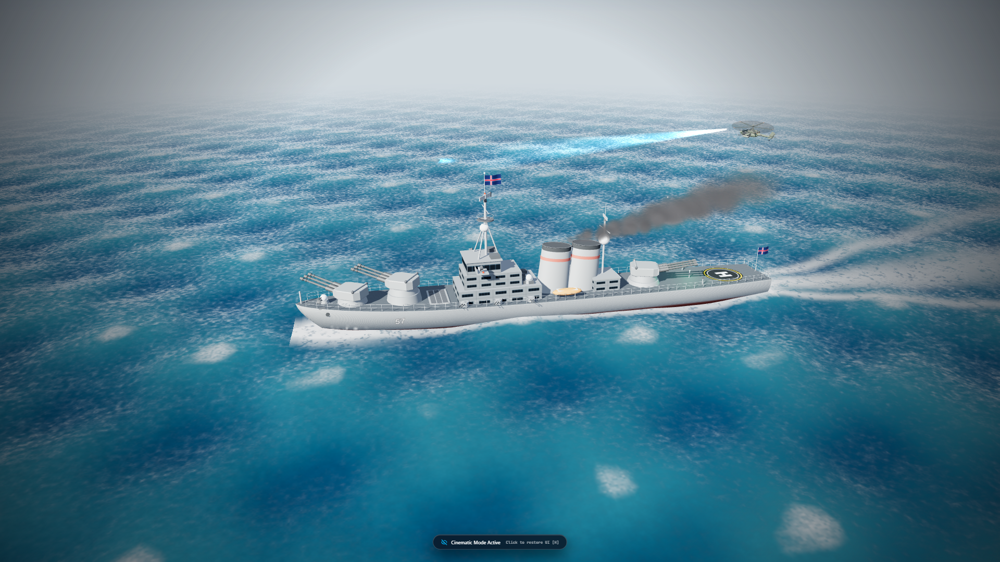
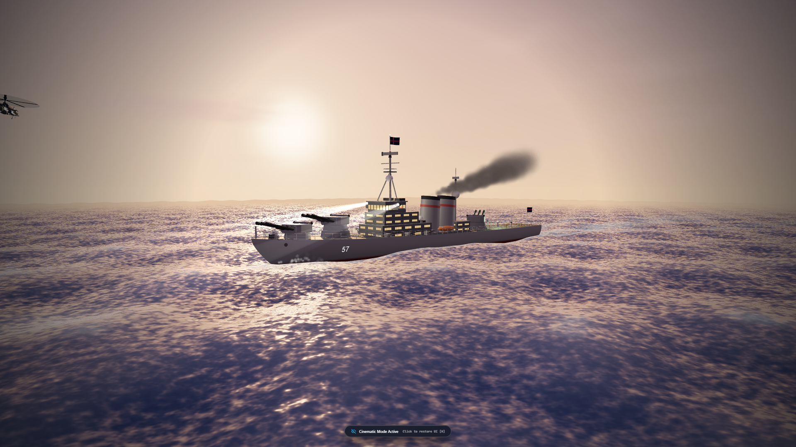

# ARMAGEDDON — Naval Warfare & Planetary Defense Simulation

A cinematic, interactive naval combat and global defense simulation inspired by *Battleship*, built with a modern decoupled stack: an authoritative Python/FastAPI backend simulation engine, tactical alien AI, realistic harbor fleet logistics, and a 3D Command Information Center (CIC) built with React Three Fiber, Motion for React, and Tailwind CSS.

---

## Sentinel Scene Showcase

This Sentinel boat and helicopter scene was developed over approximately one month, with a focus on cinematic composition, real-time 3D rendering, lighting, camera movement, ocean atmosphere, and interactive naval visualization.

### Screenshots





### Video

[Watch the Sentinel boat and helicopter scene](docs/media/sentinel-view.mp4)

The video is included in the repository so the complete scene can be downloaded and viewed locally.

## Technology Stack

- **React 19 and TypeScript** — component-based interface development with type safety.
- **Three.js, React Three Fiber, and React Three Drei** — real-time browser-based 3D scenes, models, cameras, lighting, animation, and reusable helpers.
- **WebGL** — hardware-accelerated rendering for the interactive ocean and naval environments.
- **Vite** — fast local development and optimized frontend builds.
- **Zustand** — lightweight state management for tactical and simulation state.
- **FastAPI and Python** — authoritative simulation engine and REST API.
- **WebSockets** — real-time communication between the simulation backend and command center.
- **SQLAlchemy and SQLite** — persistence for local simulation data.
- **Pytest** — automated validation of combat, harbor, weapon, countermeasure, and sensor systems.

## Key Features

1. **Authoritative Server-Side Combat Engine**:
   - Backend governs all projectile trajectories, travel times, detection radiuses, and localized subsystem damage.
   - Distinct ship damage states: `OPERATIONAL` $\rightarrow$ `DAMAGED` $\rightarrow$ `CRITICAL` $\rightarrow$ `DISABLED` $\rightarrow$ `SINKING`.
   - Localized subsystem casualties: Hull, Propulsion, Radar, Fire Control, and Countermeasures.

2. **Harbor & Fleet Logistics System**:
   - Pre-deployment task force commissioning (Destroyers, Cruisers, Carriers, Submarines).
   - Hardpoint outfitting within tonnage (35,000 tons) and budget (50,000 credits) constraints.
   - Ammunition provisioning: weapons have limited ammunition and cannot be replenished mid-ocean.
   - **Deployment Lock**: Loadouts are locked upon departure.

3. **Defensive Countermeasure Windows**:
   - Incoming threat detection triggers an alert klaxon and countdown timer.
   - Real-time tactical responses: CIWS Interceptors (Phalanx Block 1B), Chaff/Thermal Decoys, Active Electronic Jamming (AN/SLQ-32), and Emergency Rudder Evasion.

4. **Strategic Uncertainty & Sensor Modeling**:
   - Fog of war: contact reports carry confidence radiuses and error ellipses based on range, radar efficiency, and target radar cross-section (RCS).
   - False decoy contacts.

5. **Tactical Alien AI ("The Harvesters")**:
   - Operates strictly from simulated sensor perception (no omniscient cheating).
   - Fictional alien technology: Plasma Siphon Lances, Gravimetric Kinetic Spikes, Biomorphic shields.
   - State machine behaviors: Stalk, Lateral Circle Salvo, and Evasive Drift.

6. **Cinematic 3D Command Information Center**:
   - Animated dynamic ocean surface with harmonic wave displacement.
   - Procedural 3D warship models (Destroyer, Cruiser, Carrier, Submarine, and Alien Leviathan/Skiff) with realistic geometry, radar towers, rotating turrets, smoke/fire particles, and listing/sinking animations.
   - 2D Polar Tactical Radar Display with sweeping beam and interactive targeting.
   - Three camera modes: Tactical Orbit, Overhead CIC, and Action Missile Cam.
   - Procedural Web Audio API sound synthesizer (Sonar pings, Warning sirens, Rocket whooshes, and Explosions).

7. **Multi-Domain Interactive 3D Simulators**:
   - **USS Sentinel (D-57)**: Guided-missile battleship with triple 16" main turrets, 18-cell VLS, dynamic searchlights, and time-of-day sea state controls (`/sentinel_preview.html`).
   - **USS Meridian (CVN-72)**: Nuclear fleet aircraft carrier with steam catapult jet launches, arrested recovery, helicopter ops, strike air wings, RIM-116 air defense, CIWS, and anti-ship defense (`/carrier.html`).
   - **SSN-21 Abyss**: Fast-attack nuclear submarine with active/passive sonar acoustic ping, wire-guided heavy torpedoes, ballast dive/surface controls, periscope optics, and seabed navigation (`/submarine.html`).
   - **Harbinger**: Extraterrestrial strike craft with dual atmospheric flight and deep submersible diving, directed plasma siphon lances, gravimetric shredders, swarm micro-torpedoes, optical cloaking, and drone escorts (`/harbinger.html`).
   - All four simulators are selectable on the Main Menu CIC, accessible during Harbor drydock sea trials, and available via the Threat Intelligence dossier.

---

## Quick Start

### One-click launcher (Windows)

From the project folder, double-click [`start-armageddon.bat`](start-armageddon.bat). The script opens the backend and frontend in separate terminal windows and checks that the required local dependencies are available.

When the launcher finishes, open:

- Website: `http://localhost:5173`
- Backend API: `http://localhost:8000`
- API documentation: `http://localhost:8000/docs`

Keep both terminal windows open while using the website. Close them to stop the development services.

### Manual startup

#### 1. Start the Backend Simulation Engine
```powershell
cd backend
.\.venv\Scripts\uvicorn app.main:app --port 8000 --reload
```
The FastAPI server will be running on `http://localhost:8000`.

#### 2. Start the Frontend CIC Command Center
```powershell
cd frontend
npm run dev
```
Open `http://localhost:5173` in your browser.

---

## Running Automated Tests

```powershell
cd backend
.\.venv\Scripts\pytest -v
```
All simulation rules, harbor validation, weapon range, CIWS interception, and sensor models are verified via Pytest.
